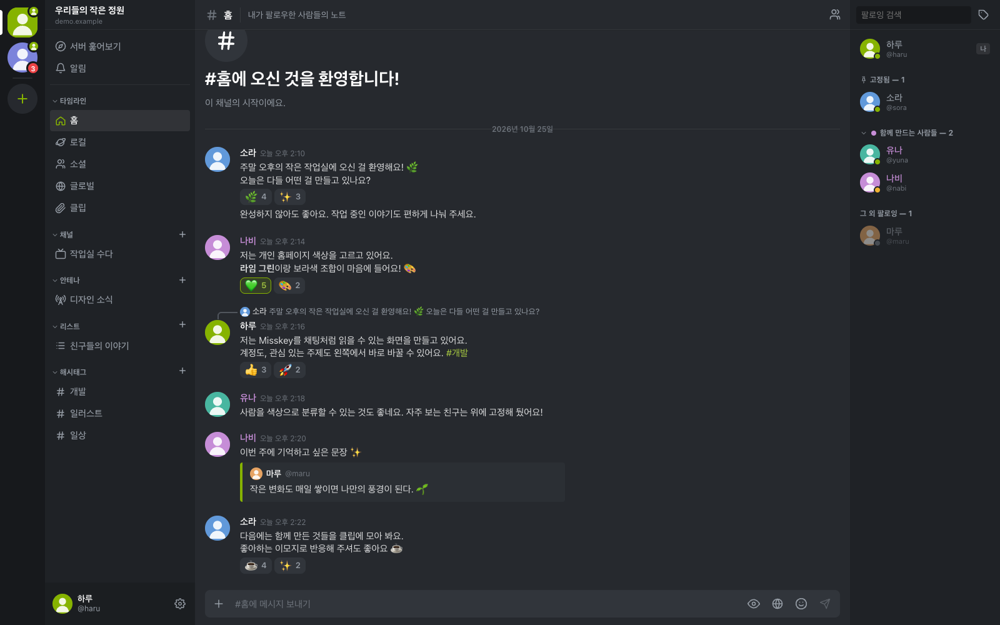
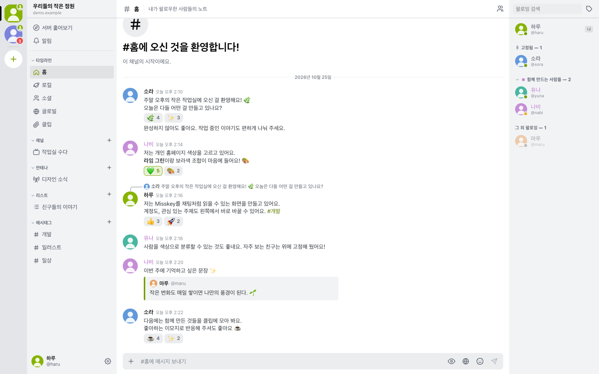
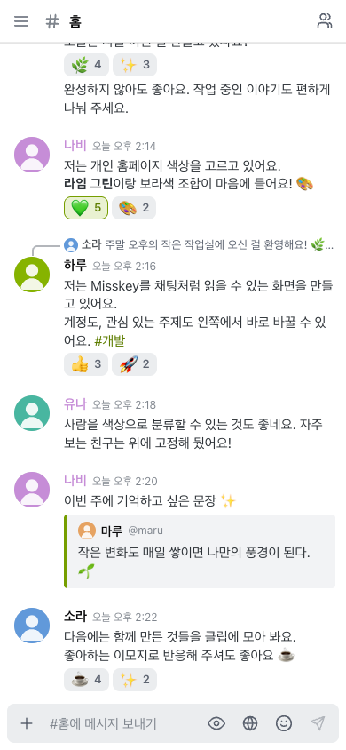

# Miscord — Misskey를 더 편하게 즐기는 방법

Miscord는 Misskey의 노트와 타임라인을 **디스코드처럼 읽고 작성하도록 구성한 웹 클라이언트**다. 기존 Misskey 계정으로 로그인하며, 게시물·팔로우·리액션 등의 데이터는 접속한 Misskey 서버에 저장된다. 자체 연합 서버를 운영하는 소프트웨어가 아니라 기존 서버에 접속하는 별도의 화면이다.

대화를 따라 읽고, 자주 보는 사람과 주제로 빠르게 이동하고, 긴 글도 편하게 작성할 수 있다. 익숙한 Misskey 기능에 디스코드식 탐색과 문서형 페이지 편집을 더했다.

## 화면 예시

아래 화면의 사용자와 대화는 기능 소개를 위한 가상 예시다.

### 데스크톱 · 다크

계정 레일, 채널 사이드바, 노트 영역, 멤버 목록이 함께 표시된다. 연속 노트 묶기, 답글 참조, 인용 카드, 리액션과 사용자 분류 색상을 확인할 수 있다.



### 데스크톱 · 라이트

같은 대화를 라이트 테마로 표시한 화면이다.



### 모바일 · 라이트

좁은 화면에서는 대화 영역을 중심으로 표시하고 상단 버튼으로 채널과 멤버 목록을 연다.



## 1. 가장 큰 차이: 타임라인을 채팅방처럼 사용

| 항목 | Misskey 기본 웹 클라이언트 | Miscord의 구현 |
| --- | --- | --- |
| 화면 구성 | 타임라인 중심이며, 데크에서는 여러 정보 열을 배치할 수 있음 | 계정 레일 → 채널 목록 → 메시지 영역 → 멤버 목록의 4단 구성 |
| 노트를 읽는 흐름 | 기본 타임라인은 최신 노트부터 확인하는 방식 | 오래된 노트가 위, 최신 노트가 아래에 쌓이는 채팅 방식 |
| 연속 게시물 | 노트 단위로 읽는 흐름 | 같은 작성자의 5분 미만 간격 연속 노트를 조건에 따라 묶어 이름·아바타 중복을 줄임 |
| 탐색 | 타임라인·리스트·안테나·채널 등의 기능을 선택 | 여러 노트 모음을 하나의 사이드바에서 채널처럼 선택 |
| 사람 접근 | 프로필과 팔로우 관계를 중심으로 탐색 | 오른쪽 멤버 목록에서 고정·분류한 사람에게 바로 접근 |
| 계정 전환 | 계정 전환 기능을 제공 | 로그인한 계정마다 왼쪽 레일에 아이콘을 배치하고 미확인 알림 배지를 표시 |

리스트·안테나·클립·리액션은 원래 Misskey에 있는 기능이다. Miscord의 특징은 이 기능들을 디스코드식 동선으로 연결하는 데 있다. 원본도 데크와 위젯을 제공하므로, 화면 개인화 자체가 Miscord에만 있는 기능이라는 의미는 아니다.

Misskey의 기능 범위는 [공식 기능 안내](https://misskey-hub.net/en/docs/for-users/features/), 원본 데크의 구성 방식은 [공식 데크 사용 안내](https://support.misskey.io/ja/articles/17028541-tips-%E3%82%BF%E3%82%A4%E3%83%A0%E3%83%A9%E3%82%A4%E3%83%B3%E3%82%82%E9%80%9A%E7%9F%A5%E3%82%82-%E3%83%87%E3%83%83%E3%82%AD%E3%81%A7%E4%B8%A6%E3%81%B9%E3%81%A6%E8%A6%8B%E3%82%88%E3%81%86)를 참고할 수 있다.

## 2. 계정과 채널을 한 화면에서 전환

### 여러 계정을 서버 레일에 배치

MiAuth로 Misskey 서버에서 접근 권한을 승인받아 로그인한다. 서로 다른 서버의 계정을 추가할 수 있으며, 레일의 아이콘을 누르면 해당 계정으로 전환한다. 같은 서버의 서로 다른 계정도 각각의 항목이 된다.

계정 순서는 드래그 또는 `Alt + ↑ / ↓`로 바꿀 수 있다. 각 계정의 미확인 알림 배지가 실시간으로 갱신되어 다른 계정의 새 알림도 확인할 수 있다. 여러 계정의 노트를 하나의 타임라인으로 합치는 구성은 아니다.

### 노트 모음을 채널처럼 탐색

| 사이드바 항목 | 표시되는 내용과 사용 방법 |
| --- | --- |
| 홈·로컬·소셜·글로벌 | Misskey의 기본 타임라인을 채팅 형태로 표시 |
| 채널 | 서버에서 팔로우하거나 즐겨찾기한 Misskey 채널을 가져옴 |
| 안테나 | 서버에 만든 안테나의 수집 결과를 표시 |
| 리스트 | 서버에 만든 사용자 리스트를 표시하고 새 리스트 생성 지원 |
| 해시태그 | 직접 등록한 태그의 노트를 표시. 본문의 태그를 눌러 열고 사이드바에 추가할 수도 있음 |
| 클립 | 내 클립을 카드 목록으로 보고, 선택한 클립의 노트를 열람 |
| 페이지 | 서버의 인기 페이지·내 페이지·좋아요한 페이지를 디스코드 포럼 갤러리처럼 커버 이미지 카드로 보고, 열람·좋아요·작성·편집·삭제 |
| 알림 | 전체 알림 또는 멘션·답글·인용을 모아 확인 |
| 서버 훑어보기 | 서버 소개, 통계, 트렌드, 인기 노트 등을 확인 |

여기서 ‘채널’은 탐색 항목을 통칭하는 UI 표현이기도 하다. 홈·리스트·해시태그를 선택했다고 별도의 Misskey 채널이 생성되는 것은 아니다. 실제 Misskey 채널 화면에서 작성할 때는 해당 채널의 노트로 게시된다. 해시태그 화면에서는 태그 자동 추가 옵션을 사용할 수 있다. 리스트·안테나는 읽기용 필터이며 그 화면에서 작성한 노트가 자동으로 수집 대상이 되는 것은 아니다.

카테고리를 접거나 항목 순서를 변경할 수 있다. 안테나 생성은 원본 Misskey 화면으로 연결하며, 새 리스트의 멤버 추가도 원본에서 진행한다.

채널·안테나·리스트·해시태그·클립·페이지는 쓰지 않는다면 설정의 **사이드바 항목**에서 스위치로 끌 수 있다. 끈 항목은 사이드바에서 통째로 사라지며, 다시 켜면 서버의 최신 목록과 함께 돌아온다. 타임라인·알림·서버 훑어보기는 항상 표시된다. 이 설정은 계정마다 따로 저장되어, 계정별로 필요한 항목만 남겨 둘 수 있다.

## 3. 채팅에 가까운 노트 표시와 실시간 읽기

- **대화 표현:** 날짜 구분선, 답글의 원문 참조 줄, 리노트 안내 줄, 인용 노트의 임베드 카드를 제공한다.
- **링크 미리보기:** 본문의 링크를 디스코드 임베드처럼 사이트명·제목·설명이 담긴 카드로 보여준다. YouTube·SoundCloud(그리고 Vimeo·Spotify 등)는 카드 안에서 바로 재생할 수 있다.
- **연속 노트 묶기:** 작성자·시간 간격·날짜·답글 및 리노트 여부를 확인해 아바타와 이름을 반복 표시하는 양을 줄인다.
- **새 노트 따라가기:** 맨 아래를 읽고 있으면 새 노트로 자동 이동한다. 과거 노트를 읽고 있거나 메뉴·이모지 선택창을 열어 둔 경우에는 새 메시지 수를 표시해 읽던 위치를 유지한다.
- **과거 기록 탐색:** 위로 스크롤하면 이전 노트를 추가로 불러오며 스크롤 위치를 보존한다.
- **실시간 반영:** 새 노트와 리액션, 노트 삭제가 화면에 반영되어 새로고침 없이 대화를 따라갈 수 있다.

사용자별 노트 화면에서는 답글을 제외한 게시물을 모아 볼 수 있다.

## 4. 멤버 목록과 개인 분류

오른쪽에는 팔로잉과 고정한 사용자가 표시된다. 검색과 온라인 상태에 따른 정렬을 지원하며, 아바타나 이름을 누르면 프로필 팝아웃이 열린다.

Miscord에서는 사람을 개인적으로 정리하는 기능을 제공한다.

- **사용자 고정:** 자주 확인하는 사람을 멤버 목록 상단에서 빠르게 찾는다.
- **이름·색상 분류:** ‘친구’, ‘개발’, ‘그림’처럼 분류를 만들고 순서를 정한다. 사용자는 한 분류에 배정되며, 분류 색이 멤버 목록과 타임라인 이름에 적용된다.
- **프로필에서 바로 행동:** 사용자 노트 열기, 팔로우·해제, 고정·해제, 분류 지정, 뮤트·차단을 수행한다.
- **기간 지정 뮤트:** 영구 또는 1시간·1일·7일 뮤트를 선택할 수 있다.

이 분류는 디스코드 역할과 비슷하게 보이는 **개인용 표시 설정**이다. Misskey 서버의 역할·권한이나 서버 리스트의 멤버 구성을 변경하지 않는다. 고정과 분류는 현재 브라우저의 해당 계정 설정에 저장된다. 반면 팔로우·뮤트·차단은 Misskey 서버에 반영된다.

## 5. 노트 작성과 반응

하단 입력창에서 노트와 투표를 작성하고, 답글·인용·리노트·리액션으로 대화에 참여할 수 있다. 메시지에 마우스를 올리면 관련 도구가 나타난다.

| 기능 | 현재 동작 |
| --- | --- |
| 전송 | 데스크톱은 `Enter` 전송, `Shift + Enter` 줄바꿈. 한글 등 IME 조합 중 전송 방지 |
| 터치 입력 | `Enter`로 줄바꿈하고 전송 버튼으로 게시 |
| 공개 범위 | 공개·홈·팔로워 전용 선택, 계정별 기본값 저장 |
| CW | 주의 문구 입력과 본문 펼치기·접기 |
| 투표 작성 | 2~10개 선택지, 복수 선택 여부, 무기한 또는 1시간·6시간·1일·3일·1주 기한 설정 |
| 첨부 | 파일 선택, 붙여넣기, 드래그 앤 드롭으로 서버 드라이브에 업로드하거나, 드라이브에서 폴더를 탐색해 기존 파일을 골라 첨부 (최대 16개) |
| 이모지 | 커스텀·유니코드 이모지 검색, 카테고리 탐색, 최근 사용 이모지 |
| 리액션 | 이모지와 개수를 표시하고 내 반응을 강조. 클릭해 추가·취소·변경하고, 마우스를 올리거나 길게 눌러 반응한 사용자 확인 |
| 리노트 | 노트당 한 번만 리노트. 도구 막대 버튼, 리노트 pill, 더 보기 메뉴에서 리노트하거나 취소하며 내 리노트를 강조 |
| 노트 관리 | 링크 복사, 원문 열기, 내 노트 삭제, 삭제 후 편집 |
| 클립 | 새 클립 생성, 노트를 클립에 추가하거나 제거 |

### 대화 중에 바로 투표 만들기

입력창의 `+` 메뉴에서 **투표**를 선택하면 같은 화면에서 질문과 선택지를 작성할 수 있다. 모임 날짜, 다음 작업 주제, 가벼운 취향 질문도 대화하던 자리에서 바로 게시할 수 있다.

- **2~10개 선택지:** 선택지를 추가하거나 정리하며 질문 구성
- **복수 선택:** 여러 답을 고를 수 있는 투표로 설정
- **마감 시간:** 무기한 또는 1시간·6시간·1일·3일·1주 중 선택
- **투표만 게시:** 본문 없이 선택지만으로도 작성 가능

게시된 투표는 노트 안에서 선택지별 득표와 막대그래프로 확인한다. 투표는 원래 Misskey의 기능이며, Miscord에서는 채팅형 입력창 안에서 작성하고 결과를 읽을 수 있도록 연결했다. 현재 투표 참여는 원본 Misskey에서 할 수 있다.

### 반응한 사람과 대화 맥락을 바로 확인

이모지 리액션에 마우스를 올리면 반응한 사용자의 아바타와 이름을 볼 수 있다. 모바일에서는 길게 눌러 확인할 수 있어, 누가 공감했는지 알아보기 위해 다른 화면으로 이동할 필요가 줄어든다. 리노트 표시에서도 같은 방식으로 리노트한 사람을 확인할 수 있다.

내가 리노트한 노트는 강조되며, 리노트 버튼을 다시 누르면 취소할 수 있다. 같은 노트를 반복해서 리노트하는 대신 켜고 끄듯 관리할 수 있다.

답글 위의 원문 참조 줄을 누르면 현재 채널에서 원노트 위치로 이동하고 해당 노트를 강조한다. 앞선 대화를 다시 찾아볼 때 유용하며, 원노트가 같은 채널에 있어야 이동할 수 있다.

### 이미 올린 파일도 다시 첨부

`+` 메뉴에서 드라이브를 열면 폴더를 탐색해 기존 파일을 선택할 수 있다. 노트에는 최대 16개까지 첨부할 수 있고, 페이지 본문과 커버 이미지에도 드라이브 이미지를 사용할 수 있다. 자주 쓰는 이미지나 작업 자료를 다시 업로드하는 수고를 줄인다.

‘삭제 후 편집’은 기존 노트를 삭제한 뒤 내용을 입력창으로 가져오는 방식이다. 재게시하면 새 노트가 되며 기존 반응과 리노트는 유지되지 않는다. 지정 공개 노트에는 이 메뉴가 제공되지 않는다.

## 6. 콘텐츠 표시, 알림, 서버 탐색

**본문과 미디어:** MFM의 기본 서식, 링크, 멘션, 해시태그, 코드, 인용, 커스텀 이모지를 표시한다. 이미지는 그리드와 확대 보기로 확인하며 민감한 이미지에는 클릭 전 블러를 적용한다. 동영상은 재생기를, 그 외 파일은 링크를 제공한다. 아바타 장식 표시도 지원한다.

**알림함:** 팔로우·멘션·답글·인용·리노트·리액션 등의 알림을 표시하고, 전체 또는 멘션 관련 알림으로 필터링한다. 알림 열람과 실시간 수신 시 읽음 상태를 반영하며, 팔로우 요청 수락·거절도 제공한다. 이는 앱 내부 알림 기능이며 백그라운드 푸시 알림 구현을 뜻하지 않는다.

**서버 훑어보기:** 서버 이름·소개·배너·버전, 사용자 및 노트 통계, 접속자 수, 인기 노트, 트렌드 태그와 추이, 추천 사용자, 서버 규칙과 약관 링크를 한 화면에서 확인한다. 서버가 API를 제공하는 항목에 한해 표시되며, 트렌드 태그를 열거나 내 해시태그 채널에 추가할 수 있다.

### 다른 서버 사용자의 아바타 장식도 함께

연합으로 만난 다른 서버 사용자도 자신이 꾸민 아바타 그대로 만날 수 있다. 접속한 서버에서 빠진 장식 정보를 원본 서버에서 보완해, 노트·멤버 목록·프로필에서 장식을 표시한다. 장식의 회전·좌우 반전·위치 조정도 반영한다. 상대 서버의 공개 정보 제공 여부에 따라 지원 범위는 달라질 수 있다.

## 7. 페이지를 문서처럼 쓰고, 갤러리처럼 둘러보기

소개글, 작업 기록, 사용 설명서처럼 노트보다 길게 남기고 싶은 이야기는 페이지로 작성할 수 있다. **Miscord는 Misskey 페이지를 하나의 문서처럼 이어 쓰는 편집기와 카드형 갤러리로 제공한다.** 타임라인을 보던 화면 안에서 페이지를 찾고, 읽고, 작성할 수 있다.

### 블록 추가보다 글쓰기에 집중

Misskey 원본은 섹션·텍스트·이미지·노트 블록을 조합해 페이지를 만든다. Miscord에서는 한 입력창에 글을 이어 쓰고, `# 제목`처럼 제목을 입력해 문서를 구성한다. 단락을 복사하거나 문장을 옮길 때도 일반 텍스트 문서를 다루듯 편집할 수 있어, 긴 글과 작성해 둔 원고를 옮기기에 편하다. 원본의 블록 구성은 [Misskey 공식 페이지 안내](https://misskey-hub.net/en/docs/for-users/features/pages/)에서 확인할 수 있다.

| 하고 싶은 일 | Miscord에서 편해지는 점 |
| --- | --- |
| 긴 글 작성 | 제목과 본문을 한 입력창에서 이어 쓰며 흐름을 유지 |
| 글의 구조 잡기 | `#`, `##`, `###` 제목으로 섹션과 하위 섹션 구성 |
| 결과 확인 | 넓은 화면에서는 글과 미리보기를 나란히 확인. 모바일에서는 작성·미리보기 탭으로 전환 |
| 이미지 넣기 | 붙여넣기·드래그 앤 드롭으로 올리거나 드라이브의 기존 이미지 선택 |
| 노트 소개 | 같은 서버의 노트 링크를 본문 한 줄에 붙여넣어 삽입. 다른 서버 노트도 ‘노트 넣기’에서 링크로 찾아 추가 |
| 서식 꾸미기 | MFM과 커스텀 이모지를 사용하고, 도구 버튼으로 제목·굵은 글씨 등을 삽입 |
| 작업 이어 하기 | 현재 브라우저에 임시 저장된 작성 내용을 복원해 계속 편집 |

예를 들어 아래처럼 쓰면 ‘이번 주 작업’ 아래에 본문과 ‘다음 할 일’ 하위 섹션이 생긴다.

```text
# 이번 주 작업
작은 홈페이지를 만들었어요. **첫 공개**를 준비하고 있습니다! 🌿

## 다음 할 일
소개글을 다듬고 작업 이미지를 추가할 예정이에요.
```

커버 이미지와 요약을 더하면 목록에서도 글의 분위기와 내용을 전할 수 있다. 글꼴·가운데 정렬·페이지 URL도 설정할 수 있으며, 작성한 페이지는 Misskey 서버에 저장되어 원본에서도 열 수 있다.

### 커버로 찾고, 탭으로 모아 보기

페이지 목록은 디스코드 포럼 갤러리처럼 커버 이미지가 있는 카드로 구성된다. 제목과 요약, 작성자를 함께 보며 읽을 글을 고를 수 있다.

- **인기:** 서버의 인기 페이지를 둘러보고 새로운 글 발견
- **내 페이지:** 직접 작성한 글을 모아 보고 편집·삭제
- **좋아요:** 마음에 들어 좋아요한 페이지를 다시 찾아 읽기

검색창에서는 현재 불러온 목록을 제목·요약·작성자로 좁힐 수 있다. 글을 열어 좋아요하거나 링크를 복사하고, 원본 Misskey 화면으로 바로 이동할 수도 있다.

페이지 자체와 좋아요·커버 설정은 Misskey가 제공하는 기능이다. Miscord는 이를 **한 화면에서 찾기 쉬운 갤러리와 글쓰기에 집중할 수 있는 편집 방식**으로 연결한다.

## 8. 취향에 맞는 화면, 모바일에서도

다크·라이트·시스템 테마를 선택하고, 기본 라임 그린 외에도 프리셋이나 직접 고른 강조색을 사용할 수 있다. 유니코드 이모지는 Twemoji와 시스템 이모지 중 선택한다. 좁은 화면에서는 채널과 멤버 목록을 필요할 때 열어 대화에 집중할 수 있다. 홈 화면에 설치해 앱처럼 실행하는 것도 가능하다.

계정별 채널 순서·사이드바 항목 표시 여부·사용자 고정·분류와 화면 설정은 현재 브라우저에 저장된다. 다른 기기로 자동 동기화되지는 않으며, 페이지 임시 저장본도 같은 브라우저에서 이어 쓸 수 있다.

## 이용 전에 알아두면 좋은 점

서버 버전과 설정에 따라 사용할 수 있는 기능이 달라질 수 있다. 기존 로그인 계정에서 페이지·드라이브 접근 권한을 요청하면 다시 로그인해 권한을 추가하면 된다.

페이지 편집은 글·섹션·이미지·노트 중심이며, 복잡한 기존 페이지는 저장 전 미리보기로 구성을 확인하는 것이 좋다. 투표 작성과 결과 확인을 지원하며, 투표 참여·지정 공개 작성·상세 계정 및 서버 관리는 원본 Misskey를 이용할 수 있다.
